# Awaaz Pakistan — Phase 0 Audit & Baseline

Branch: `polish/final`. Scope: `awaaz_backend/` (FastAPI) and `awaaz_pakistan/` (React + Vite). No application code was changed for this audit.

Line references point at the committed tree (`HEAD` = `a076f2d`). Note: the working tree has uncommitted edits to `awaaz_backend/main.py` (CORS/admin-key warnings) and `awaaz_backend/routers/complaints.py` (`run_in_threadpool` around ffmpeg/Whisper/Ollama). They are not part of this audit commit, were not present when the baseline was measured (`concurrency.json` → `findings.voice_handler_is_async_def_calling_sync_blocking_code: true`), and shift some line numbers in those two files if applied.

All numbers below come from these raw files; nothing is estimated:

| Source | Path |
|---|---|
| Environment | `awaaz_backend/bench/results/baseline/env.json` |
| Latency | `awaaz_backend/bench/results/baseline/latency.json` |
| CPU/RAM | `awaaz_backend/bench/results/baseline/resource.json` |
| Concurrency | `awaaz_backend/bench/results/baseline/concurrency.json` |
| Frontend build / Lighthouse / FPS | `awaaz_backend/bench/results/baseline/frontend.json` (see note) |
| Tests / lint | `awaaz_backend/bench/results/baseline/tests.json` |
| UI screenshots | `awaaz_pakistan/ui-baseline/INDEX.md` |

Note: the brief names `awaaz_pakistan/ui-baseline/results-frontend.json`. That file does not exist. The orchestrator `awaaz_pakistan/ui-baseline/scripts/frontend_bench.ps1` writes its summary to `awaaz_backend/bench/results/baseline/frontend.json` (script header, step 5), and the raw Lighthouse reports live in `awaaz_pakistan/ui-baseline/lighthouse/*.report.{html,json}`. Frontend numbers here are taken from that file.

Reference mockup (`https://claude.ai/artifact/5F9FCccYnhy1o8GtcBVJae`): fetched once; the response was a 59-byte page shell ("Claude Artifact") with no content, since the artifact is rendered client-side/behind auth. It could not be used. Gap-filling in later phases will need a screenshot or export from you.

---

## 1. Architecture map

### 1.1 Backend API routes

All routers are mounted under `settings.API_PREFIX = "/api"` (`config.py:22`, `main.py:65-68`). "Admin key" = `verify_admin_api_key` dependency checking `X-API-Key` (`auth.py:23-49`). There is no JWT anywhere in the codebase; `auth.py` is a shared-secret API key (the brief's "JWT `auth.py`" is inaccurate).

| Method | Path | Auth | Handler (file:line) | Notes |
|---|---|---|---|---|
| GET | `/` | public | `main.py:93-108` | sync `def`; app info + placeholder helplines. Used as frontend health check (`api.js:39`) |
| POST | `/api/complaints/voice` | public | `routers/complaints.py:112-195` | multipart `audio`, `location_area`, `shop_name`, `lat`, `lng`; 201 `ComplaintResponse` |
| POST | `/api/complaints/text` | public | `routers/complaints.py:198-246` | JSON `TextComplaintRequest` |
| GET | `/api/complaints` | public | `routers/complaints.py:249-323` | filters + `page`/`limit` (≤100), returns full rows incl. transcripts, shop names, exact lat/lng |
| GET | `/api/complaints/{id}` | public | `routers/complaints.py:326-336` | full row |
| PATCH | `/api/complaints/{id}` | admin key | `routers/complaints.py:339-380` | status / notes / assigned authority |
| GET | `/api/rates` | public | `routers/rates.py:10-55` | sync `def` |
| GET | `/api/rates/{item_id}` | public | `routers/rates.py:58-82` | sync `def` |
| POST | `/api/rates/reload` | **public** | `routers/rates.py:85-101` | state-mutating, no auth |
| POST | `/api/rates/check` | public | `routers/rates.py:104-148` | |
| GET | `/api/analytics/overview` | public | `routers/analytics.py:19-25` | |
| GET | `/api/analytics/hotspots` | public | `routers/analytics.py:28-34` | |
| GET | `/api/analytics/repeat-offenders` | public | `routers/analytics.py:37-42` | returns shop names publicly |
| GET | `/api/analytics/trends` | public | `routers/analytics.py:45-53` | `days` 1–90 |
| GET | `/api/analytics/map/points` | public | `routers/analytics.py:56-95` | coords rounded to 3 dp, up to 2000 raw points |
| GET | `/api/admin/health` | public | `routers/admin.py:26-68` | DB `SELECT 1`, Ollama ping |
| GET | `/api/admin/config` | admin key | `routers/admin.py:71-92` | |
| GET | `/api/admin/shops/{shop_name}` | admin key | `routers/admin.py:95-179` | 5 sequential queries |
| POST | `/api/admin/reseed` | admin key | `routers/admin.py:182-192` | seeds demo data into live DB |
| GET | `/api/admin/export` | admin key | `routers/admin.py:195-256` | CSV, capped at 5000 rows |

Frontend also calls two routes that do not exist: `/api/process-complaint` (fallback on 404, `api.js:79-83`) and `/api/stats` (`api.js:336`).

### 1.2 Services and modules

| Module | Role |
|---|---|
| `main.py` | App factory, lifespan (init DB → load rates → load Whisper + ping Ollama, `main.py:22-39`), CORS, global handlers |
| `config.py` | `pydantic-settings` `Settings` (Whisper `base`/cpu, Ollama `qwen2.5:1.5b-instruct`, SQLite URL, CORS, admin key, helplines) |
| `auth.py` | `X-API-Key` check with `hmac.compare_digest` |
| `ai_pipeline.py` | `AIPipeline` singleton: openai-whisper load/transcribe, Ollama chat with JSON schema, hybrid rules+LLM reconciliation |
| `services/audio.py` | ffmpeg resolution, convert to 16 kHz mono PCM WAV, duration, silence check |
| `services/nlp_rules.py` | Urdu digits, Urdu/Roman Urdu/Punjabi/Pashto number words, price extraction, language detection, keyword classifier, native acknowledgements |
| `services/rates.py` | `RateService` singleton over `rate-list.json`, alias map, RapidFuzz matching, price comparison |
| `services/analytics.py` | KPI, hotspots, repeat offenders, trends queries; hardcoded twin-city coordinate table |
| `db/session.py` | Async engine (aiosqlite), session factory, `create_all` |
| `db/models.py` | `Complaint` model |
| `schemas.py` | Pydantic request/response models |
| `scripts/seed_demo_data.py` | Demo data seeder (used by `/api/admin/reseed`) |
| `timeutils.py` | naive-UTC helpers |
| `_verify.py` | Manual smoke script against a running server (see finding D-1) |
| `bench/` | Phase 0 benchmark harness (not app code) |

### 1.3 Database: `complaints` table (`db/models.py:10-53`)

| Column | Type | Null | Index |
|---|---|---|---|
| `id` | String(36) PK, uuid4 | no | PK |
| `created_at` | DateTime | no | yes |
| `updated_at` | DateTime | no | — |
| `audio_filename` | String(255) | yes | — |
| `audio_duration_seconds` | Float | yes | — |
| `transcript_raw` | Text | no | — |
| `detected_language` | String(50) | no | — |
| `category` | String(100) | no | yes |
| `urgency` | String(20) | no | yes |
| `status` | String(30) | no | yes |
| `extraction_confidence` | Float | no | — |
| `needs_review` | Boolean | no | yes |
| `item_name` | String(100) | yes | yes |
| `item_canonical_id` | String(50) | yes | yes |
| `unit`, `reported_price`, `official_price`, `price_difference_pkr`, `percentage_overcharge` | String/Float | yes | — |
| `native_response` | Text | no | — |
| `routing_agency`, `helpline_reference` | String(100) | no | — |
| `location_area` | String(200) | yes | yes |
| `shop_name` | String(200) | yes | yes |
| `lat`, `lng` | Float | yes | **no** (`db/models.py:49-50`) |
| `admin_notes` | Text | yes | — |

No composite indexes, no Alembic migrations (schema created by `Base.metadata.create_all`, `db/session.py:23-26`). No STT confidence, GPS accuracy, timestamp, geohash or region columns.

### 1.4 Frontend structure

Routes (`src/App.jsx:24-28`): `/` → `Home` (eager), `/admin` → `Admin` (lazy, `App.jsx:8`), `*` → `NotFound`. No separate public dashboard route; the admin portal is the dashboard (`ui-baseline/INDEX.md`).

Key modules: `hooks/useAudioRecorder.js` (MediaRecorder), `hooks/useGeolocation.js` (GPS), `sections/ReportSection.jsx` (submission flow), `lib/api.js` (axios client + demo fallbacks), `components/avatar/*` (R3F avatar + 2D `AvatarLite`), `components/map/*` (Leaflet: `LocationPicker`, `AdminMap`, `MiniLocationMap`), `i18n/*` (EN/UR + RTL).

### 1.5 Data flow: mic → dashboard

```mermaid
flowchart LR
  A[Mic: getUserMedia\nuseAudioRecorder.js:51] --> B[MediaRecorder\nwebm;codecs=opus first\nuseAudioRecorder.js:88-97]
  B --> C[Blob -> FormData 'audio'\nfilename recording.webm/m4a/wav\napi.js:58-69]
  G[useGeolocation.js:40\nlat,lng,accuracy] -->|only lat,lng if consent\nReportSection.jsx:133-147| C
  C -->|POST /api/complaints/voice\naxios timeout 35s api.js:8| D[FastAPI async handler\ncomplaints.py:112]
  D --> E[save temp file\ncomplaints.py:133-134]
  E --> F[ffmpeg 16kHz mono WAV\n+ duration + volumedetect\naudio.py:123-189]
  F --> H[openai-whisper base CPU\nthreading.Lock\nai_pipeline.py:189-207]
  H --> I[rules: price, item, language\nai_pipeline.py:300-303]
  I --> J[Ollama qwen2.5:1.5b JSON schema\ntemp 0.1, 2 attempts\nai_pipeline.py:253-293]
  J --> K[reconcile + rate compare\nneeds_review\nai_pipeline.py:318-455]
  K --> L[(SQLite complaints\ncomplaints.py:187-189)]
  L --> M[analytics service\nservices/analytics.py]
  L --> N[GET /api/complaints limit 100\nAdmin.jsx:110, poll 10s Admin.jsx:153]
  M --> O[Admin dashboard: Leaflet + Recharts]
  N --> O
  K -->|201 JSON| P[Verdict card + R3F avatar + speechSynthesis\nReportSection.jsx:169-193]
```

Details:

- MIME: first supported of `audio/webm;codecs=opus`, `audio/webm`, `audio/mp4`, `audio/wav`, `audio/ogg` (`useAudioRecorder.js:88`). Chunks every 100 ms (`useAudioRecorder.js:116`). Browser-side echo cancellation, noise suppression and AGC are on (`useAudioRecorder.js:52-56`).
- Upload: `multipart/form-data` via axios; on network error or any 5xx the client fabricates a demo success (`api.js:95-111`).
- The whole pipeline (save → ffmpeg → Whisper → Ollama → DB) runs inside the HTTP request (`complaints.py:131-191`).
- Whisper is loaded once in lifespan (`main.py:35` → `ai_pipeline.py:146-149`), lazily re-tried per request if load failed (`ai_pipeline.py:179-182`). `latency.json` confirms `whisper_loads_during_requests: 0`.

---

## 2. Findings (with file:line)

### 2.1 Bugs

- **B-1 Concurrent uploads return HTTP 500.** At 20 concurrent uploads 5/20 failed with 500; at 50, 30/50 failed (`concurrency.json` levels). The failures completed STT and LLM (`server_stt_s`, `server_llm_s`, `llm_returned_json: true` on failed requests), so they fail after inference, in the DB write path (`complaints.py:187-189`), which is consistent with SQLite write-lock contention under the default aiosqlite engine (`db/session.py:7-11`, no timeout / WAL / pool config). Root cause not confirmed from server logs; to be verified in Phase 5.
- **B-2 Event loop blocked by sync work in `async def`.** `submit_voice_complaint` is `async def` but calls blocking file I/O (`complaints.py:133-134`), ffmpeg `subprocess.run` (`complaints.py:137` → `audio.py:159`), Whisper (`complaints.py:145`) and Ollama (`complaints.py:155`) directly. Same for `/text` (`complaints.py:213`). Measured effect: an unrelated `GET /` probe took up to 37.5 s at c=5, 149.2 s at c=20, 353.2 s at c=50 (`concurrency.json` → `probe_under_load_latency_s.max`).
- **B-3 Frontend timeout below real latency under load.** axios `timeout: 35000` (`api.js:8`). Every request at c=5/20/50 exceeded 35 s (`would_exceed_frontend_axios_timeout_35s` = 5, 20, 50). The 60 s clip already reaches p95 20.1 s unloaded (`latency.json`).
- **B-4 Silent fake success on outage.** Any network error or 5xx on voice/text submit returns a fabricated `DEMO_SCENARIOS.urdu_violation` result with `success: true` (`api.js:95-111`, `api.js:141-157`). Combined with B-1, real citizens can see a "complaint registered" verdict for a complaint that was never stored. `isDemo` is returned, but whether the UI surfaces it to the citizen was not verified.
- **B-5 LLM `detected_language` is ignored by a no-op branch.** `if llm_lang: final_detected_lang = det_lang` (`ai_pipeline.py:385-386`) assigns the value it already had.
- **B-6 Canned-phrase hallucination filter drops legitimate input.** `"shukriya"` is in the discard list (`ai_pipeline.py:224-229`); a complaint consisting only of "shukriya" is fine to drop, but the check is exact-match only, so real hallucinations like "Thank you for watching." (with punctuation) are not caught.
- **B-7 STT confidence is a proxy, not a signal.** `avg_confidence = 1 - mean(no_speech_prob)` (`ai_pipeline.py:231-234`); `avg_logprob` and language probability are not used, and the result is not persisted (no column in `db/models.py`). `latency.json` shows `stt_confidence_proxy: 1.0` on clean synthetic speech.
- **B-8 Whisper output language falls back to `"ur"` on error** (`ai_pipeline.py:186`, `ai_pipeline.py:212`), so a failed transcription looks like an Urdu one.
- **B-9 Missing ffmpeg degrades into a misleading 400.** In the as-is run without ffmpeg on PATH, every voice request returned 400 "No audible speech detected" with `stt_error: "[WinError 2] The system cannot find the file specified"` (`latency.json` → `as_is_without_ffmpeg_on_path`). openai-whisper shells out to `ffmpeg` itself; `services/audio.py:25-53` resolves the imageio binary for its own calls only. The real cause is swallowed (`ai_pipeline.py:206-214`).
- **B-10 Tests depend on a pre-existing DB.** `tests/test_api.py` uses `TestClient(app)` without a `with` block, so lifespan/`init_db` never runs; 8 DB tests fail on a fresh DB (`tests.json` → `finding_tests_depend_on_preexisting_db`).
- **B-11 CSV export comment says BOM, code does not add one.** Comment at `routers/admin.py:249` vs `content=buffer.getvalue()` with `charset=utf-8` (`routers/admin.py:250-251`). Excel on Windows may garble Urdu.
- **B-12 Repeat-offender items are not area-scoped.** Group by `(shop_name, location_area)` (`services/analytics.py:186`) but item lookup filters by shop only (`services/analytics.py:198-202`).
- **B-13 Duplicate/wrong hotspot coordinates.** `"karachi company"` shares G-9's coordinates and `"satellite town"` shares Commercial Market's (`services/analytics.py:18-26`); unknown areas collapse to Islamabad centre (`services/analytics.py:37-43`).

### 2.2 Dead code / unused

- **D-1 `_verify.py` is not referenced anywhere.** No import, script, CI or doc reference (repo-wide search for `_verify` returns no matches). It is a manual smoke test that hardcodes `BASE = "http://127.0.0.1:8000"` and the demo admin key (`_verify.py:10-11`) and writes test complaints into whatever DB the server uses (`_verify.py:38-40`). Candidate to move into `tests/` or delete (needs your approval).
- **D-2** `AIPipeline.transcribe_audio` (`ai_pipeline.py:243-246`) has no callers in routers.
- **D-3** `extract_price_and_normalize` imported but unused in `routers/complaints.py:21`; `normalize_digits`, `parse_word_numbers` imported but unused in `ai_pipeline.py:12-14`; `res` unused at `ai_pipeline.py:161`.
- **D-4** `services/audio.py:9` imports `HTTPException, status` but never uses them.
- **D-5** `config.OLLAMA_TIMEOUT` (`config.py:33`) is never passed to `ollama.Client` (`ai_pipeline.py:158`), so LLM calls have no timeout.
- **D-6** `leaflet.markercluster` is a dependency (`awaaz_pakistan/package.json:21`) but no import exists in `src/components/map/*.jsx` or `src/pages/Admin.jsx`.
- **D-7** Unused Vite scaffold assets `src/assets/react.svg`, `src/assets/vite.svg`; `src/App.css` (184 lines) is not imported by `App.jsx` / `main.jsx` (only `index.css`, `main.jsx:3`). Verify before deletion.
- **D-8** Frontend fallbacks to non-existent routes `/api/process-complaint` (`api.js:79-83`) and `/api/stats` (`api.js:336`).

### 2.3 Duplicated logic

- `classify_category_and_urgency` is called up to three times per complaint (`ai_pipeline.py:372`, `ai_pipeline.py:410`, `ai_pipeline.py:426`).
- The agency/helpline mapping is duplicated in `services/nlp_rules.py:380-411` and `ai_pipeline.py:427-432`.
- Voice and text handlers build an identical `Complaint(...)` (`complaints.py:161-185` and `complaints.py:216-240`).
- Three different area lists: `NOTABLE_AREAS` (`complaints.py:33-37`), `TWIN_CITIES_COORDS` (`services/analytics.py:17-32`), and the frontend `marketCoordinates` used at `LocationPicker.jsx:170`.
- Status validation lives in the route (`complaints.py:361-366`) instead of a Pydantic `Literal` in `schemas.py:53-54`.

### 2.4 Missing error handling

- No upload size check before reading: the whole body is written to disk (`complaints.py:133-134`) before the 25 MB check (`audio.py:140-142`). No content-type / magic-byte validation; the extension comes from the client filename (`complaints.py:128`), which is also used in the temp path.
- No Ollama request timeout (D-5); `time.sleep(0.3)` blocks between retries (`ai_pipeline.py:291`).
- `/api/admin/health` calls `ai_pipeline._ollama_client.list()` synchronously inside `async def` (`routers/admin.py:47-52`).
- No structured/request-ID logging; f-string logging throughout (e.g. `ai_pipeline.py:206`).
- `rates.reload()` failure only returns 500 (`routers/rates.py:88-93`); fine, but the route is unauthenticated (S-3).

### 2.5 Hardcoded secrets, paths, CORS

- **S-1** Default admin key `awaaz-admin-2024` in `config.py:50` and forced back by the validator when empty (`config.py:58-59`), in `.env.example:32`, `docker-compose.yml:29` and `_verify.py:11`. Because the validator never returns an empty string, the "no key configured = opt out" branch in `auth.py:31-33` is unreachable.
- **S-2** CORS: `CORS_ORIGINS = ["*"]` default (`config.py:42`) with `allow_credentials=True` (`main.py:56-62` at HEAD), also `CORS_ORIGINS=*` in `docker-compose.yml:26` and `.env.example:26`. Credentialed wildcard is invalid per the CORS spec. (An uncommitted working-tree change addresses this; see header.)
- **S-3** `POST /api/rates/reload` is unauthenticated (`routers/rates.py:85-86`).
- **S-4** Public endpoints leak PII/precise data: `GET /api/complaints` and `/{id}` return transcripts, shop names, exact `lat`/`lng` (`schemas.py:62-90`, `complaints.py:249-336`); `/api/analytics/repeat-offenders` names shops publicly (`routers/analytics.py:37-42`). Only `/map/points` coarsens coordinates (`routers/analytics.py:86-88`).
- **S-5** Admin key held in `sessionStorage` and attached to every request including public ones (`api.js:12`, `api.js:28-34`).
- **S-6** Hardcoded paths: `DATABASE_URL` relative `./awaaz.db` (`config.py:36`) depends on CWD; `docker-compose.yml:34` bind-mounts `./awaaz.db`, which Docker creates as a directory if the file is missing. `uvicorn.run(..., reload=True)` in `main.py:117`. `DEBUG: bool = True` default (`config.py:21`).
- **S-7** Hardcoded frontend API base `http://localhost:8000` (`api.js:4`) and third-party CDNs (Google Fonts `index.html:13`, unpkg Leaflet CSS `index.html:16`, CARTO tiles `AdminMap.jsx:148`, `LocationPicker.jsx:209`).
- **S-8** No rate limiting on any public route.

### 2.6 Models / blocking / queries

- Models per request: **no**. Whisper is loaded at startup only (`latency.json` → `whisper_loads_during_requests: 0`; `concurrency.json` → `whisper_load_model_calls_during_requests: 0`). Whisper load took 0.723 s; full `pipeline_initialize` 2.797 s; server startup wall 6.085 s (`latency.json` → `model_load_events`, `server_startup_wall_s`).
- Whisper and LLM inside the request cycle: **yes** (`concurrency.json` → `findings.whisper_and_llm_inside_request_cycle: true`). Whisper is serialised by a `threading.Lock` (`ai_pipeline.py:189`), so throughput is bounded to one transcription at a time.
- Sync blocking in async routes: see B-2; also `routers/admin.py:47-52`.
- Pagination: present on `/api/complaints` (`complaints.py:265-266`, `limit ≤ 100`). Missing on `/api/analytics/trends`, which loads every full `Complaint` row in the window into Python (`services/analytics.py:224-230`). `/api/admin/export` loads up to 5000 rows into memory (`routers/admin.py:208`). `/map/points` returns up to 2000 raw points (`routers/analytics.py:58`).
- **N+1 queries:** `get_hotspots` runs 2 extra queries per area (`services/analytics.py:139-158`, up to 1 + 20); `get_repeat_offenders` 1 extra per shop (`services/analytics.py:198-203`); `get_overview` runs 6 sequential queries (`services/analytics.py:50-104`); `get_shop_profile` 5 (`routers/admin.py:110-151`).
- Missing indexes: `lat`, `lng` (`db/models.py:49-50`); no composite indexes for common filters (e.g. `created_at` + `category`). `ilike('%…%')` searches (`complaints.py:281-305`) cannot use indexes.
- Admin portal polls `getComplaints({limit: 100})` + hotspots + offenders every 10 s (`Admin.jsx:110-113`, `Admin.jsx:153`); home polls every 15–30 s (`RecentComplaintsSection.jsx:34`, `LiveTicker.jsx:28`, `LiveImpactStatsSection.jsx:39`).

### 2.7 Three.js / R3F

- Pixel ratio **is capped**: `dpr={[1, 1.5]}` (`AvatarCanvas.jsx:82`).
- **No pause on hidden tab or off-screen:** no `frameloop` prop on `<Canvas>` (`AvatarCanvas.jsx:81-90`) and no `visibilitychange` handling anywhere in `src/` (search returns no matches). `useFrame` runs every frame (`ProceduralAvatar.jsx:50-104`).
- **No explicit dispose:** no `dispose` calls in `src/`. Geometries/materials are declarative JSX, which R3F disposes on unmount, so the leak risk is mainly the `new THREE.Color` per state change (`ProceduralAvatar.jsx:19-34`) and the `<points>` subtree mounted/unmounted on every THINKING toggle (`ProceduralAvatar.jsx:215-233`). Not measured as a leak; heap profiling is NOT MEASURED.
- Heavy materials: 4 `meshPhysicalMaterial` with clearcoat/transmission (`ProceduralAvatar.jsx:119-186`); transmission forces an extra render pass. Sphere at 48×48 segments (`ProceduralAvatar.jsx:118`). `powerPreference: 'high-performance'` (`AvatarCanvas.jsx:87`).
- 2D fallback **exists**: `AvatarLite` on reduced-motion, missing WebGL, or WebGL error boundary, plus a manual toggle (`AvatarCanvas.jsx:56-79`, `AvatarController.jsx:19-27`). No low-end-device heuristic (e.g. `deviceMemory`, FPS-based downgrade).
- `vendor-three` chunk is 806,582 bytes (218.16 kB gzip) and is loaded on the home route (`frontend.json` → `build`).
- `useAudioRecorder` calls `setVolumeLevel` on every animation frame (`useAudioRecorder.js:81-82`), re-rendering the recorder tree ~60×/s while recording; same pattern for `setMouthAperture` in `useLipSync.js:41-42`.

### 2.8 GPS handling (present, partial)

The frontend already does GPS:

- `getCurrentPosition` with `enableHighAccuracy: true, timeout: 10000, maximumAge: 0` (`useGeolocation.js:34-40`).
- States idle/requesting/success/denied/timeout/unavailable/low_accuracy (`useGeolocation.js:3-11`); `>100 m` warning (`useGeolocation.js:49-51`).
- Consent checkbox gate (`LocationPicker.jsx:116-133`, `useGeolocation.js:20-23`); draggable pin (`LocationPicker.jsx:63`); market dropdown fallback (`LocationPicker.jsx:170-171`).

Gaps:

- Only `lat`/`lng` are sent; `accuracy` and the position `timestamp` are dropped (`ReportSection.jsx:133-134`, `api.js:68-69`). `timestamp` is never read (`useGeolocation.js:42`).
- Manual pin sets a fake `accuracy = 10` (`LocationPicker.jsx:63`); market pick sets 150 (`LocationPicker.jsx:171`). No `location_source` is sent, although `AdminMap.jsx:109-111` reads `c.location_source`, which the backend never returns.
- Error messages are English-only strings in the hook (`useGeolocation.js:21-71`), not from `translations.js`.
- No province/district/city selection; dropdown covers only twin-city markets.
- Backend: no validation at all on `lat`/`lng` (`complaints.py:117-118`, `schemas.py:49-50`); `(0,0)`, out-of-Pakistan and `lat=500` are accepted. No reverse geocoding, no spoken-vs-GPS reconciliation, no geohash/region column, no server-side clustering. `bbox` filter allows any world bbox (`complaints.py:76-109`).

### 2.9 RTL / Urdu fonts

- `dir="rtl"`, `lang` and `.font-urdu` on `<body>` when language is `ur` (`LanguageContext.jsx:16-25`). Default `lang="en"` in `index.html:2`.
- Noto Nastaliq Urdu loaded from Google Fonts with `display=swap` (`index.html:13`), render-blocking stylesheet; font weight is large and not subset.
- `.font-urdu` uses `line-height: 1.8` (`index.css:157-161`) only when the whole UI is Urdu; Urdu transcripts/acknowledgements shown in English mode do not get the Nastaliq font or `dir="auto"` unless components add it (not verified per component).
- `speakText` picks `ur-PK` only when `detected_language === 'Urdu'`; Roman Urdu/Punjabi/Pashto responses are read with `en-US` (`ReportSection.jsx:191`).

### 2.10 Accessibility

- Lighthouse accessibility 93 (home) and 88 (admin/dashboard) (`frontend.json` → `lighthouse`). Per-audit failures are in `awaaz_pakistan/ui-baseline/lighthouse/*.report.json` and were not itemised here.
- Record button has `aria-label` (`ReportSection.jsx:336`); FAQ uses `aria-expanded` (`FaqSection.jsx:51`); privacy modal has `role="dialog"`/`aria-modal` (`PrivacyModal.jsx:15-16`).
- FAQ button removes focus outline (`FaqSection.jsx:51` `focus:outline-none`) without a visible replacement.
- No `aria-live` region anywhere in `awaaz_pakistan/src/` (repo search returns no matches), so processing/result/GPS status changes are not announced to screen readers.
- Avatar 3D/2D toggle relies on `title` only (`AvatarController.jsx:23`).

### 2.11 Brand tokens vs brief

The brief states Emerald `#006633` / `#004D25`. The shipped UI uses a violet/cosmic palette: `--accent-violet: #814bee` (`index.css:11`), background `#030014` (`index.css:5`, `index.html:18`), glass `rgba(19,21,21,0.7)` + `blur(16px)` (`index.css:68-73`). Under the UI preservation rules the current UI is the source of truth, so this is raised as question Q-9, not a finding to fix.

### 2.12 Domain scope vs brief

The shipped classifier has 3 categories (`ai_pipeline.py:46-49`, `services/nlp_rules.py:366-420`) focused on price gouging, food safety and municipal issues in Islamabad/Rawalpindi; urgency is Low/Medium/High (`ai_pipeline.py:51-53`). The Phase 2 target schema (electricity, gas, water supply, hospital, school; `critical` urgency; `summary_en/ur`, `entities`) is broader. The Whisper `initial_prompt` is grocery-only (`ai_pipeline.py:25-30`) with none of WASA/WAPDA/SNGPL/LESCO. LLM `temperature` is 0.1, not 0 (`ai_pipeline.py:269`). No emergency keywords (fire, gas leak, flood, accident) in the rules (`services/nlp_rules.py:374-406`).

### 2.13 `.kilo/` and `.gitignore`

- `.kilo/kilo.jsonc` contains only `{"snapshot": false}`; `.kilo/agents/data.md` is a generic Kilo "notebook-first data analysis agent" prompt. Nothing project-specific or secret. Both are tracked in git. Not relevant to the app; could be gitignored.
- `.gitignore` coverage (verified with `git check-ignore -v`):
  - `awaaz_backend/awaaz.db` → ignored by `awaaz_backend/.gitignore:18` (`*.db`) and root `.gitignore`; not tracked (`git ls-files` does not list it).
  - `awaaz_backend/.env` → ignored (`awaaz_backend/.gitignore:13`); `.env.example` is allowed and tracked.
  - `awaaz_backend/venv/` → ignored (`awaaz_backend/.gitignore:8`).
  - `awaaz_backend/uploads/` → ignored (`awaaz_backend/.gitignore:23`); `*.wav`, `*.m4a`, `*.webm`, `*.mp3` ignored. **`*.ogg` is not ignored** — the three bench fixtures `bench/fixtures/synthetic_en_*.ogg` are intentionally tracked, but any stray `.ogg` upload would be too.
  - `awaaz_pakistan/.env` → ignored only via root `.gitignore:26`; `awaaz_pakistan/.gitignore` has no `.env` rule (only `*.local`).
  - Root `.kiro/` is untracked and not ignored.

---

## 3. Baseline metrics

### 3.1 Environment (`env.json`)

| Item | Value |
|---|---|
| OS | Windows 11 (10.0.26200) |
| CPU | AMD64 Family 25 Model 80 (AuthenticAMD), 6 physical / 12 logical cores |
| RAM | 15.41 GiB total, 1.75 GiB available at measurement time |
| GPU | none usable; torch `2.14.1+cpu`, CUDA not available |
| Python | CPython 3.14.7 (temporary baseline venv) |
| Whisper | openai-whisper `base`, device `cpu` |
| LLM | Ollama `qwen2.5:1.5b-instruct`, GGUF Q4_K_M, 1.5B, 986,061,892 bytes, reachable |
| Limits | max audio 120 s, upload 26,214,400 bytes |

This is the "Target hardware" the brief left as `[FILL IN]`; please confirm production matches (Q-1). Available RAM was only 1.75 GiB, which may have affected results.

Fixtures: 10 s / 30 s / 60 s **synthetic English TTS** (Microsoft David, Opus 32 kb/s Ogg), `bench/fixtures/manifest.json`. Not valid for any Urdu accuracy claim.

### 3.2 End-to-end latency, sequential (`latency.json`)

Real route `POST /api/complaints/voice`, uvicorn 1 worker, temp SQLite, loopback client, n = 3 per clip (p95 ≈ max at n = 3). Seconds, median (p95).

| Clip | Upload | Preprocess (ffmpeg) | STT | LLM | Rules | DB write | Server total | Client total | STT RTF |
|---|---|---|---|---|---|---|---|---|---|
| 10 s | 0.0019 (0.0020) | 0.1562 (0.1589) | 2.0568 (2.0734) | 3.7309 (3.8501) | 0.0006 (0.0007) | 0.0106 (0.0108) | 5.9791 (6.0845) | 5.9811 (6.0855) | 0.206 |
| 30 s | 0.0019 (0.0021) | 0.1700 (0.1814) | 3.7207 (3.7671) | 3.7537 (4.5701) | 0.0009 (0.0013) | 0.0080 (0.0084) | 7.7229 (8.4043) | 7.7233 (8.4049) | 0.124 |
| 60 s | 0.0023 (0.0025) | 0.2232 (0.2363) | 6.3639 (6.6185) | 7.4387 (13.4849) | 0.0013 (0.0015) | 0.0080 (0.0092) | 14.3233 (20.0964) | 14.3239 (20.0970) | 0.106 |

All 9 requests returned 201 with LLM JSON (`llm_returned_json_count` = 3 each). Cold first request (10 s clip): 8.2367 s client total, STT 2.1849 s, LLM 5.9269 s. Upload bytes: 32,629 / 105,071 / 211,691.

As-is run without ffmpeg on PATH: all clips returned 400 "No audible speech detected" with Whisper error `[WinError 2]` (B-9). The table above used an ffmpeg shim (hardlink of the imageio-ffmpeg binary) on PATH (`latency.json` → `ffmpeg_shim_main_run`).

Reproduce: `cd awaaz_backend; python bench/latency_bench.py --iterations 3`.

### 3.3 CPU / RAM during processing (`resource.json`)

psutil every 0.25 s. CPU% is per process, 100 = one logical core, ceiling 1200. Server tree includes ffmpeg children; Ollama measured separately.

| Phase | Server CPU % mean / p95 / max | Server RSS MB mean / max | Ollama CPU % mean / max | Ollama RSS MB max | System CPU % mean | System RAM used % max |
|---|---|---|---|---|---|---|
| idle after startup | 0.0 / 0.0 / 0.0 | 720.4 / 720.4 | 0.0 / 0.0 | 81.0 | 32.0 | 88.9 |
| cold first request | 163.8 / 593.1 / 600.5 | 732.7 / 818.3 | 2.0 / 28.1 | 81.0 | 78.4 | 89.4 |
| 10 s clips | 195.7 / 586.6 / 604.3 | 720.4 / 745.9 | 3.4 / 73.6 | 82.2 | 86.5 | 88.7 |
| 30 s clips | 277.5 / 597.9 / 620.5 | 709.6 / 737.2 | 2.1 / 50.7 | 82.4 | 80.8 | 88.7 |
| 60 s clips | 239.4 / 602.2 / 623.2 | 715.0 / 750.3 | 0.9 / 52.2 | 80.9 | 76.8 | 88.9 |

Caveat: Ollama RSS of ~81 MB is far smaller than the 986 MB model, so the model runner process was likely not captured by the `ollama*` name filter. Ollama CPU/RAM should be treated as **under-reported** until re-measured.

Reproduce: produced by `bench/latency_bench.py` alongside latency.

### 3.4 Concurrency (`concurrency.json`)

N simultaneous uploads of the 10 s fixture; uvicorn 1 worker; client timeout 1800 s. Probe = `GET /` every 250 ms.

| N | Wall s | 201 | Failures | Throughput req/s | Latency p50 / p95 s | > 35 s axios timeout | Probe under load max s | Median STT s | Median LLM s |
|---|---|---|---|---|---|---|---|---|---|
| 5 | 37.849 | 5 | 0 | 0.132 | 37.812 / 37.839 | 5 | 37.5067 | 2.448 | 4.383 |
| 20 | 150.365 | 15 | 5 × HTTP 500 | 0.100 | 149.779 / 150.297 | 20 | 149.2197 | 2.081 | 4.171 |
| 50 | 354.181 | 20 | 30 × HTTP 500 | 0.056 | 353.561 / 354.040 | 50 | 353.203 | 2.037 | 4.207 |

Unloaded probe median: 0.0136 / 0.0046 / 0.0051 s. LLM fallback count 0 at every level. All requests in a level finish at about the same time, which is what a blocked event loop produces. During c=5 system RAM peaked at 94.7 %.

Reproduce: `cd awaaz_backend; python bench/concurrency_bench.py --levels 5 20 50`.

### 3.5 Frontend (`frontend.json`)

Build (`vite build`, uncompressed / gzip):

| Chunk | Bytes | gzip |
|---|---|---|
| `vendor-three` | 806,582 | 218.16 kB |
| `vendor-charts` | 364,929 | 101.25 kB |
| `vendor-leaflet` | 289,448 | 88.65 kB |
| `index` (app) | 231,776 | 70.34 kB |
| `index.css` | 89,053 | 13.43 kB |
| `Admin` | 34,739 | 8.82 kB |
| `vendor-motion` | 19,860 | 5.74 kB |
| **Total assets** | **1,836,387** | — |

Lighthouse (vite preview, headless Chrome):

| Page | Form factor | Performance | Accessibility | FCP | LCP | TBT | CLS | Speed Index |
|---|---|---|---|---|---|---|---|---|
| Home `/` | mobile | 29 | 93 | 6.3 s | 6.9 s | 9,990 ms | 0 | 7.6 s |
| Home `/` | desktop | 76 | 93 | 1.2 s | 1.2 s | 410 ms | 0.013 | 1.4 s |
| Dashboard `/admin` | mobile | 69 | 88 | 4.9 s | 5.0 s | 0 ms | 0 | 5.1 s |
| Dashboard `/admin` | desktop | 94 | 88 | 1.0 s | 1.4 s | 0 ms | 0 | 1.0 s |

Runtime, mid-range phone profile (390×844, 4× CPU throttle via CDP, host/software GPU, not a real device):

| Page | Wall `goto` ms | DOMContentLoaded ms | Load ms | 3D FPS |
|---|---|---|---|---|
| Home | 15,602 | 820 | 828 | 56.3 (563 frames / 10.01 s) |
| Dashboard (`/admin`) | 2,698 | 1,011 | 1,020 | n/a (no canvas) |

`first_contentful_paint_ms` was `null` in the runtime probe; use Lighthouse FCP above.

Reproduce: `cd awaaz_pakistan; pwsh -File .\ui-baseline\scripts\frontend_bench.ps1`.

### 3.6 Tests / lint (`tests.json`)

| Check | Result |
|---|---|
| Backend `python -m pytest -q tests` (temp DB, schema pre-created) | 39 passed, 1 warning, 41.50 s |
| Frontend `npm run lint` (oxlint) | 0 warnings, 0 errors |

There are no frontend unit tests.

### 3.7 NOT MEASURED

| Metric | Reason | How to reproduce / unblock |
|---|---|---|
| WER / accuracy on Urdu, Roman Urdu, Punjabi, Sindhi, Pashto, Balochi | No real or synthetic non-English audio exists; only English SAPI voices are installed (`bench/make_fixtures.py` docstring, `manifest.json` note) | Provide labelled real samples; Phase 1/2 eval harness in `awaaz_backend/eval/` |
| NLP category/urgency accuracy, JSON validity rate on a labelled set | No labelled dataset exists | Phase 2 eval harness |
| 3D FPS on a real mid-range phone | Only CDP CPU-throttle emulation on host GPU (`frontend.json` → `runtime.profile.note`) | Run `ui-baseline/scripts/perf.mjs` against a real Android device via remote debugging |
| JS heap / Three.js memory leak over time | Not part of the baseline scripts | Chrome DevTools heap snapshots across state toggles |
| Ollama runner CPU/RAM (accurate) | Name filter likely missed the runner process (see 3.3 caveat) | Extend `ResourceSampler` in `bench/_common.py` to include child processes of `ollama` |
| GPU inference latency | No CUDA (`env.json`) | Re-run `latency_bench.py` on a CUDA host |
| Lighthouse on a public dashboard route | No public dashboard route exists | n/a until a route exists |

---

## 4. UI baseline screenshots

Index: [awaaz_pakistan/ui-baseline/INDEX.md](awaaz_pakistan/ui-baseline/INDEX.md). Eight states (home, recording, uploading, success, error, admin, dashboard, not-found) at 390, 768 and 1440 px, 24 PNGs. "Dashboard" is the `/admin` route because there is no public dashboard. WebGL canvas frames are not pixel-deterministic (noted in INDEX.md), so visual diffs need a tolerance mask on the avatar region.

---

## 5. Prioritized issue list

Phase tags: 1 STT accuracy, 2 NLP/LLM accuracy, 3 GPS, 4 performance, 5 scalability, 6 security/privacy, 7 testing/observability, 8 accessibility/UX.

### Critical

| # | Issue | Evidence | Phase |
|---|---|---|---|
| C-1 | Whisper + LLM run inside the request; event loop blocked; `GET /` waits up to 353 s | B-2, §3.4 | 4 |
| C-2 | Concurrent uploads fail with HTTP 500 after inference (5/20, 30/50) | B-1, §3.4 | 5 |
| C-3 | Client fakes success on 5xx/network error, hiding lost complaints | B-4 (`api.js:95-111`) | 8 |
| C-4 | Public endpoints expose transcripts, shop names and exact GPS | S-4 | 6 |
| C-5 | Default admin key shipped and unremovable; credentialed CORS wildcard | S-1, S-2 | 6 |

### High

| # | Issue | Evidence | Phase |
|---|---|---|---|
| H-1 | All loaded requests exceed the 35 s axios timeout | B-3 | 4 |
| H-2 | No backend validation of lat/lng (bbox, (0,0), range); accuracy/timestamp not sent or stored | §2.8 | 3 |
| H-3 | No real STT confidence (avg_logprob, no_speech_prob, lang prob) stored or used for review | B-7 | 1 |
| H-4 | Whisper prompt and categories are grocery-only; no civic vocabulary or emergency rules | §2.12 | 1, 2 |
| H-5 | Missing ffmpeg surfaces as "no speech" 400 | B-9 | 1 |
| H-6 | No Ollama timeout; temperature 0.1; no Pydantic validation/repair loop | D-5, `ai_pipeline.py:253-293` | 2 |
| H-7 | Home mobile Lighthouse Performance 29, TBT 9,990 ms; 806 kB three.js chunk on landing | §3.5 | 4 |
| H-8 | Unauthenticated `POST /api/rates/reload` | S-3 | 6 |
| H-9 | No upload size/type check before writing; client filename in temp path | §2.4 | 6 |
| H-10 | No WER/NLP eval set at all | §3.7 | 7 |

### Medium

| # | Issue | Evidence | Phase |
|---|---|---|---|
| M-1 | N+1 queries in hotspots/repeat offenders/shop profile; trends loads full rows | §2.6 | 5 |
| M-2 | No index on lat/lng; no geohash/region; no migrations (Alembic) | §1.3 | 3, 5 |
| M-3 | `/map/points` sends up to 2000 raw points; no server-side clustering; markercluster unused | `routers/analytics.py:58`, D-6 | 3 |
| M-4 | R3F canvas never pauses (hidden tab/off-screen); per-frame React state updates | §2.7 | 4 |
| M-5 | Admin polls 100 rows every 10 s | `Admin.jsx:110-153` | 4 |
| M-6 | Tests depend on pre-existing DB | B-10 | 7 |
| M-7 | No structured logging / request IDs / metrics | §2.4 | 7 |
| M-8 | Admin a11y score 88; FAQ focus outline removed; no `aria-live` for status | §2.10 | 8 |
| M-9 | GPS error strings English-only; no province/district/city fallback | §2.8 | 3, 8 |
| M-10 | Duplicate classify/agency logic; three separate area lists | §2.3 | 2 |
| M-11 | No rate limiting | S-8 | 6 |
| M-12 | Spoken-location vs GPS reconciliation absent | §2.8 | 3 |

### Low

| # | Issue | Evidence | Phase |
|---|---|---|---|
| L-1 | `_verify.py` unused, hardcodes demo key | D-1 | 7 |
| L-2 | Unused imports/functions/assets, non-existent API fallbacks | D-2–D-4, D-7, D-8 | 7 |
| L-3 | No-op language branch; exact-match hallucination filter | B-5, B-6 | 1, 2 |
| L-4 | CSV export lacks the BOM its comment promises | B-11 | 8 |
| L-5 | Hotspot coordinate duplicates; repeat-offender items not area-scoped | B-12, B-13 | 3 |
| L-6 | Render-blocking Google Fonts/unpkg CSS; Nastaliq not subset | §2.9 | 4 |
| L-7 | `.ogg` and `awaaz_pakistan/.env` not ignored locally; `.kilo/` tracked | §2.13 | 6 |
| L-8 | TTS uses `en-US` for Roman Urdu/Punjabi/Pashto responses | `ReportSection.jsx:191` | 8 |
| L-9 | `DEBUG=True` and `reload=True` defaults | S-6 | 6 |

---

## 6. Conflicts and open questions

Each needs your decision before the related phase starts.

- **Q-1 Target hardware.** Baseline machine: 6C/12T AMD, 15.4 GiB RAM, no GPU, Windows 11. Options: (a) treat this as production target; (b) give production specs and re-baseline there. Recommendation: (a) for now, re-run benches on the real host before Phase 4 sign-off.
- **Q-2 STT engine.** Options: (a) keep openai-whisper; (b) swap to faster-whisper (CTranslate2 int8 on CPU), adds `faster-whisper` dep and removes the torch dependency for STT. Recommendation: (b), gated on a measured Phase 1 comparison; this is a dependency swap needing approval.
- **Q-3 Whisper model size.** Current `base`; brief asks to compare `small` vs `medium`. On this CPU, base STT is RTF 0.106–0.206 (§3.2); medium will be several times slower. Recommendation: benchmark `small` and `medium` (int8) on real Urdu clips, expect `small` to be the CPU choice. Needs real Urdu samples from you (Q-4).
- **Q-4 Evaluation audio/data.** No Urdu or regional audio exists. Options: (a) you provide real anonymised samples; (b) synthetic TTS (no good Urdu voices installed); (c) public corpora (e.g. Common Voice Urdu) with licence check. Recommendation: (a) + (c); mark all synthetic items.
- **Q-5 Category/urgency schema change.** Phase 2 schema (category/sub_category, `critical`, summaries, entities, confidence) changes DB columns and the API response. Options: (a) add new nullable columns alongside existing ones (non-breaking); (b) replace existing fields (breaking, frontend changes). Recommendation: (a) with an Alembic migration (new dep) and keep current fields stable.
- **Q-6 Job queue for 202 + job_id.** Options: (a) in-process `asyncio` worker + DB job table (no new infra); (b) Redis + RQ/arq; (c) Celery. Recommendation: (a) first since there is one machine and Whisper is serialised anyway; design the job table so (b) can be added later. Changes `/voice` from 201 to 202, which needs frontend polling (UI must remain visually identical).
- **Q-7 Database.** SQLite write contention is the likely cause of C-2. Options: (a) SQLite with WAL + busy timeout + single writer; (b) Postgres (+PostGIS later). Recommendation: (a) now, keep schema PostGIS-ready, (b) when deploying multi-worker.
- **Q-8 Public data exposure.** Making `GET /api/complaints` coarse/redacted for anonymous callers changes what the public "Recent complaints" and ticker show (`RecentComplaintsSection.jsx:20`, `LiveTicker.jsx:15`). Options: (a) redact transcripts/shop names/coords for anonymous callers; (b) new public endpoint and keep the old one admin-only. Recommendation: (b), since the UI can keep the same look with the new endpoint.
- **Q-9 Brand colours.** Brief says Emerald `#006633`/`#004D25`; shipped UI is violet `#814bee` on `#030014` (§2.11). Recommendation: keep current UI as the source of truth (per your rules) unless you explicitly approve a re-theme.
- **Q-10 Demo fallback on errors.** Removing the fake success (C-3) changes what users see during outages (an error state instead of a verdict). Options: (a) show the existing error state; (b) keep demo mode only when an explicit `VITE_DEMO_MODE` flag is set. Recommendation: (b).
- **Q-11 GPS already exists.** The frontend already has consent, high-accuracy GPS, >100 m warning, pin drag and market dropdown (§2.8). Recommendation: extend rather than rebuild (send accuracy/timestamp/source, translate messages, add province/district/city fallback in existing styling).
- **Q-12 Offline reverse geocoding.** Needs a Pakistan admin-boundary GeoJSON (e.g. geoBoundaries ADM1–ADM3) and possibly `shapely` (new dep). Recommendation: approve GeoJSON + shapely; no external geocoder.
- **Q-13 LLM size.** LLM is ~3.7–7.4 s median per request (§3.2). Options: keep 1.5B; benchmark 3B/7B Q4. Recommendation: benchmark 3B in Phase 2 only after the eval harness exists; no swap without approval.
- **Q-14 Auth model.** Brief mentions JWT; code uses a shared `X-API-Key`. Options: (a) keep API key, require a non-default key in production; (b) add JWT with per-magistrate accounts (new deps, new login flow UI). Recommendation: (a) for this effort.
- **Q-15 Cleanup.** Delete or move `_verify.py`, unused assets, `App.css`, `.kilo/`? Recommendation: move `_verify.py` checks into pytest, remove the rest after confirming they are unused.
